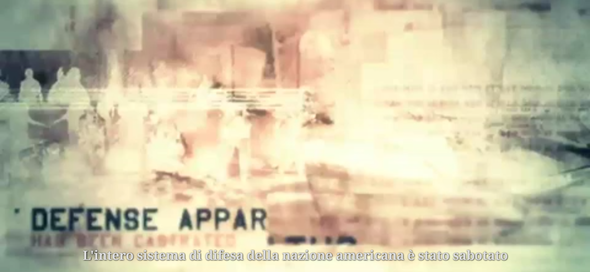
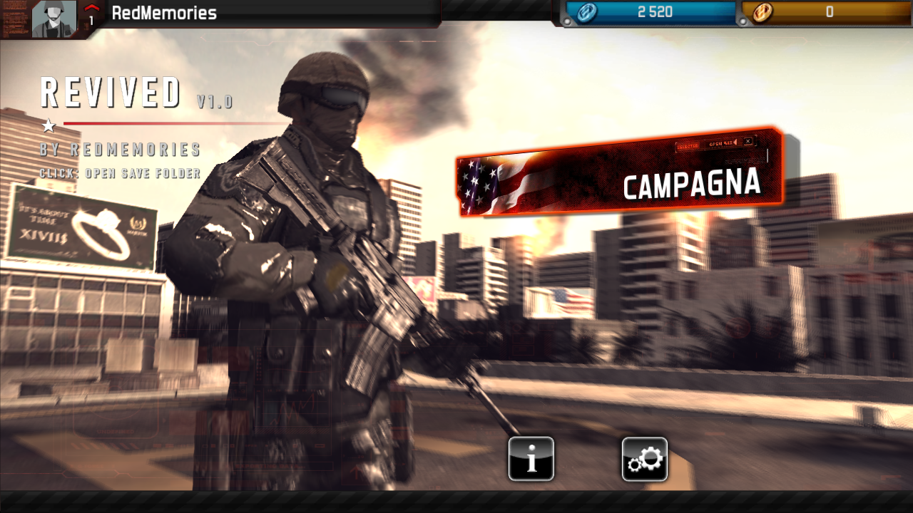

# Modern Combat 3 Revived

[](screenshots/main-menu.png)

> Modern Combat 3: Fallen Nation is a game by Gameloft. This is a non-commercial fan project, not affiliated with Gameloft. The game was pulled from the stores years ago. This repo is my private archive, please don't share the release files.

**Download: [Releases](../../releases)**: Android (64-bit) and PC (Windows).

## What I did

I didn't remake the game and I didn't touch the gameplay. The campaign, the weapons, the maps and the enemies are exactly the ones from 2011.

As with Modern Combat 4, I recompiled the whole engine to 64-bit code ahead of time: 28,964 of its 28,968 functions, rebuilt for today's phones. The game now runs as a modern native 64-bit app, at 120 fps on my phone.

Once it was running, I gave it the treatment it deserves on a modern phone:

- **HD textures.** The iOS version had 900+ textures at double resolution: faces, uniforms, weapons and buildings. They're now in the Android game, converted to a format every Android GPU can read.
- **The highest graphics profile on every GPU.** The game only knew the phones of 2011 and gave every newer GPU the low-end profile. Now everyone gets the best one, with 32-bit color, 16x anisotropic filtering and 4x anti-aliasing.
- **Full screen at the screen's native resolution**, edge to edge on today's tall displays.
- **Mission briefings with subtitles in your language.** The original Android version never showed them.
- **Controller support** in the menus and in the game, using the game's own controller mode: the touch controls disappear while you play with the controller. Tested with an Xbox layout; PlayStation and Switch controllers use the same button positions.
- **Gyroscope aiming**, with calibration and sensitivity in the game options.
- **Touch controls that work on tall screens**: swiping from the edges to aim no longer triggers Android's back gesture.
- **A crash that closed the game** after going back to the menu from a mission a few times is fixed. It was a bug in the original 2011 engine.
- **Settings**: long-press the game icon → **Settings**: graphics quality, frame rate limit (max, 90 or 60) and an **Anti-aliasing** on/off switch for phones that have trouble with it.

[](screenshots/hd-textures-before-after.png)

*Top: the original Android textures. Bottom: the HD ones.*

## Bring your save (#5)

You can import your own `SaveGame.bin`: tap **REVIVED by RedMemories** in the main menu → **Import**, and pick the file (pick `CheckPoint.bin` too, if you have it, to continue mid-mission). The game checks the file first and makes a backup of your current save in `Download/ModernCombat3Revived/Saves`. **Export** copies your save there, so you can move it to another phone or to the PC.

Your progress stays yours: credits, rank and unlocks are the ones in your save, nothing is unlocked for you.

Saves from the old Gameloft APKs should work too, since the file format is the same, but I didn't have one to test. If yours is rejected, please attach it to issue #5.

## Offline, no ads

The game is fully offline, with no ads and no tracking. Gameloft's online services don't exist anymore: the game never reaches them, and the buttons that sent you there (LIVE!, Twitter, Customer care, the "+" that opened the paid shop) are gone. The in-game shop that uses the credits you earn by playing still works. The game data is packed inside the APK, so there's nothing to download separately.

Multiplayer is hidden in this version: it comes in a later update.

[](screenshots/briefing.png)

## Install

### Android

1. Download `ModernCombat3Revived.apk` from **Releases**
2. Install it
3. Open it. The first launch takes a few seconds to unpack the game, after that it starts right away

Requirements: 64-bit Android phone with **Android 10 or newer**, about **4 GB** of free space. I play it on a Galaxy S26 Ultra. I haven't tried it on phones without a Snapdragon chip yet (MediaTek Dimensity, Exynos, Google Tensor), but I checked all the game's shaders against a strict graphics driver, the kind those phones use, and fixed the one that would have broken there. If you play on one of them, let me know how it runs.

### PC (Windows 10/11, 64-bit)

1. Download `ModernCombat3Revived-PC.zip` from **Releases** and extract it
2. Double-click `ModernCombat3Revived.exe`

Nothing else to install. It needs a graphics card with Direct3D 11. Keyboard and mouse (WASD, mouse to aim, left click fire, right click aim, R reload, G grenade, Shift sprint, Esc pause) or a controller. All the controls and options are in `README.txt` inside the zip.

Your PC save is in the `save\app` folder: click **REVIVED by RedMemories** in the main menu to open it. Phone and PC saves are the same file, so you can move your progress between them.

[](screenshots/pc-main-menu.png)

### Updates

When a new version comes out you don't need the big download again: install `ModernCombat3Revived-update.apk` over the game, or extract `ModernCombat3Revived-PC-update.zip` over your PC folder. Your saves are kept.

## Reporting problems

- **Android:** go to the home screen, **long-press the game icon → Save report**. The file is saved in `Download/ModernCombat3Revived`. If the game crashes, a report is saved there automatically.
- **PC:** `save\log.txt` in the game folder.

Please open an issue with the file and say which version you have: it's on the main menu, next to **REVIVED**.

## Screenshots

[](screenshots/helicopter.png)

[](screenshots/rooftop.png)

[](screenshots/mission-1.png)

## What's next

- multiplayer, in a separate update
- ragdoll physics: people asked for them. MC3's engine has no physics engine at all (its deaths are animations), so it would mean adding one from scratch. I want to look into it, but no promises

## Credits

Revived by **RedMemories**

Thanks to the [dynarmic](https://github.com/azahar-emu/dynarmic) project: its ARM decoder is the base of the recompiler, and it runs the game engine in the PC version.

Original game by Gameloft.

## 🎮 What should I revive next?

Request a game or vote for the next one on **[redmemories.it](https://www.redmemories.it)**: the most voted games are the first ones I look at.

## ☕ Support my work

If you enjoy my projects and would like to support my work, you can send a tip in **USDC on the Polygon network**. Every project I create is and will always remain free, but any support is greatly appreciated and helps me keep working on new projects and improvements.

```
0x0e1C11ccA29E9D2AAa9384eE0d5464f4d079E61D
```

⚠️ Send only **USDC on Polygon** to this address: other tokens or networks could be lost.

Thank you for your support! ❤️
