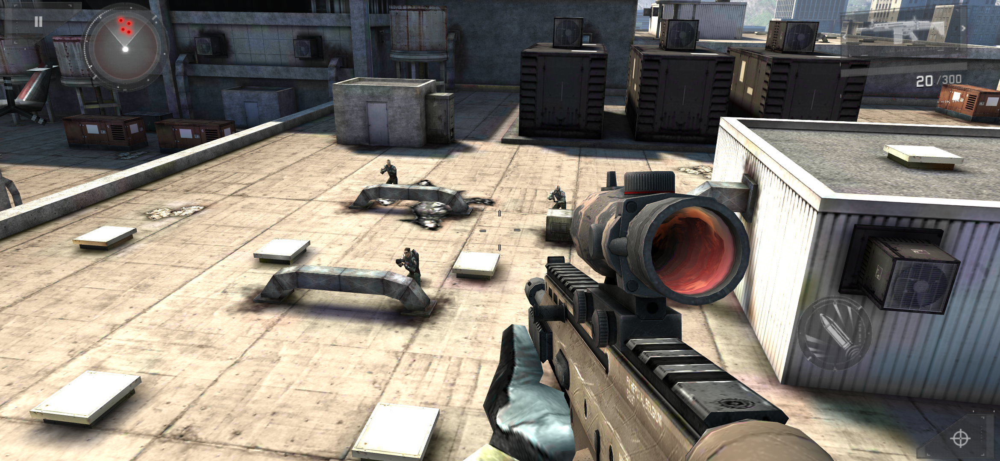

# Modern Combat 3 Revived

Progress: **50%**

`█████░░░░░`

> Modern Combat 3: Fallen Nation is a mobile game by Gameloft. This is a non-commercial fan project, not affiliated with Gameloft. The game was pulled from the stores years ago.

## A note from me

It's taking me a bit longer than planned, because I stopped to fix the issues people reported in my other games right away. Hopefully nobody has problems anymore after those updates haha.

Anyway, I'm making the game fully playable, and hopefully bug-free from the start on every device, so I won't have to update it many times. There will still be updates later for multiplayer, and I think that's where the problems will start. I'll use the same approach as MC4.

## Where it's at

- **Native 64-bit: done.** The whole engine is converted to native 64-bit code: 28,964 of its 28,968 functions. It runs on today's 64-bit-only phones as a modern app.
- **The campaign is playable** on my test phone: title screen, menus, mission briefings with their videos and subtitles, and Mission 1 with shooting, moving and the story scenes, at 120 fps.
- Native resolution and full screen, edge to edge.
- Music, voices and sound effects work.
- Saves work: "Continue" brings you back where you left off.

## What's next

- Best graphics on every phone, not only Snapdragon. Antialiasing will be on by default, and you'll be able to turn it off by long-pressing the game icon and opening **Settings**, like in MC4.
- HD textures: the iOS version has 900+ textures at double resolution, and I'm bringing them in.
- Controller and gyroscope support.
- Fully offline, with the buttons to dead Gameloft services hidden.
- Multiplayer comes later, in a separate update.
