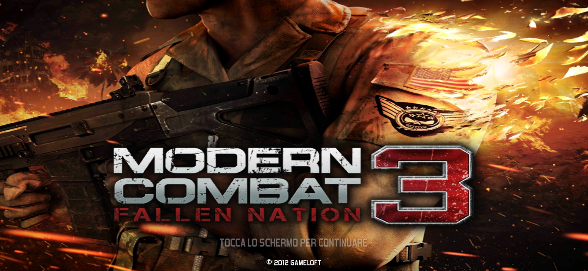
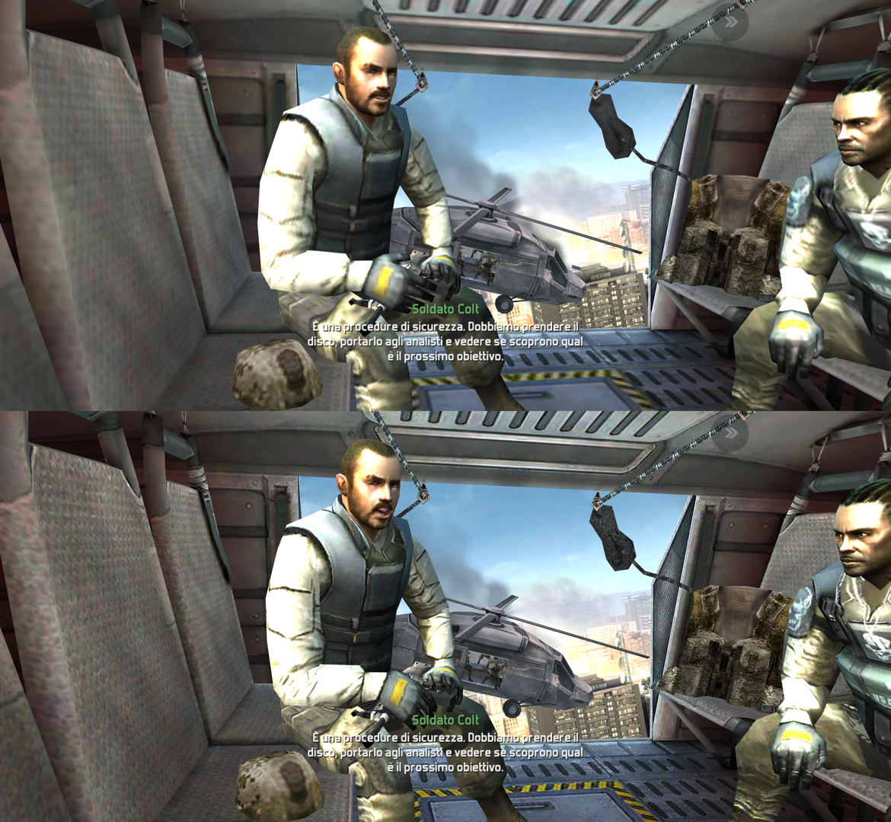
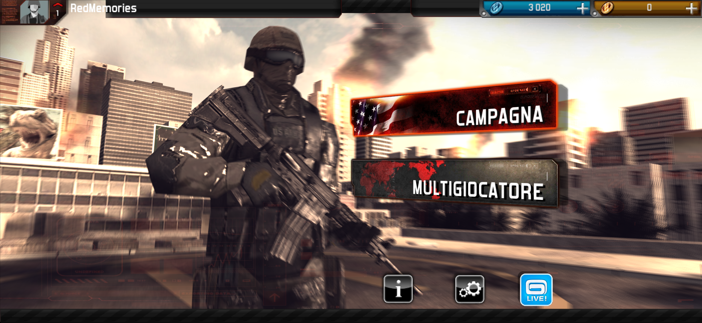
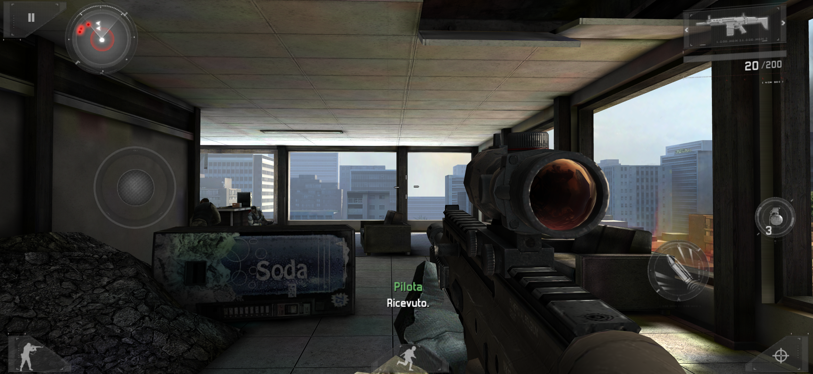

# Modern Combat 3 Revived

Progress: **79%**

`████████░░`

> Modern Combat 3: Fallen Nation is a mobile game by Gameloft. This is a non-commercial fan project, not affiliated with Gameloft. The game was pulled from the stores years ago.

## A note from me

It's taking me a bit longer than planned, because I stopped to fix the issues people reported in my other games right away. Hopefully nobody has problems anymore after those updates haha.

Anyway, I'm making the game fully playable, and hopefully bug-free from the start on every device, so I won't have to update it many times. There will still be updates later for multiplayer, and I think that's where the problems will start. I'll use the same approach as MC4.

## Where it's at

- **Native 64-bit: done.** The whole engine is converted to native 64-bit code: 28,964 of its 28,968 functions. It runs on today's 64-bit-only phones as a modern app.
- **The campaign is playable** on my test phone: title screen, menus, mission briefings with their videos and subtitles, and Mission 1 with shooting, moving and the story scenes, at 120 fps.
- **HD textures: done.** The iOS version had 900+ textures at double resolution. They're now in the Android game: faces, uniforms, weapons and buildings are much sharper.
- **Best graphics on every phone:** the game always uses its highest graphics profile, with 32-bit color, 16x anisotropic filtering and 4x antialiasing.
- **Controller support: done.** It works in menus and in game, with the touch controls hidden while you play with the controller. Tested with an Xbox layout; PlayStation and Switch controllers use the same button positions.
- **Gyroscope aiming: done**, with calibration and sensitivity in the game options.
- Touch controls work right up to the screen edges, without triggering Android's back gesture.
- I checked all of the game's shaders against a strict graphics driver, the kind non-Snapdragon phones use, and fixed the one that would have broken there.
- Native resolution and full screen, edge to edge.
- Music, voices and sound effects work.
- Saves work: "Continue" brings you back where you left off.

### HD textures, before and after

Top: the original Android textures. Bottom: the new HD ones.

### Screenshots

## What's next

- Crash reports and a "Save report" shortcut, like in MC4, so problems on your phone can be fixed quickly.
- Settings, by long-pressing the game icon: quality, fps limit, and an **Antialiasing** on/off switch for phones that have issues with it.
- Fully offline, with the buttons to dead Gameloft services hidden.
- Final APK, then the release.
- Multiplayer comes later, in a separate update.
